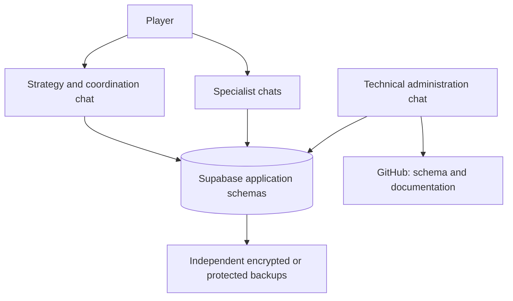

# Architecture

## Design goals

Keep the system small, inexpensive and auditable. A dedicated PostgreSQL database in Supabase is the shared source of operational facts; AI chats are specialist interfaces, not independent databases.

The strategic chat coordinates goals and priorities. Specialist chats own their subject-area workflows. A technical administration chat controls schema, contracts and permissions. Chat identities are conventions, not database-enforced roles under the current administrative connector.

## Authority

| Information | Authority |
|---|---|
| Current inventory, operational facts, runtime contract | Supabase |
| Versioned technical source and architecture decisions | Git |
| Recoverable player data | Independent native backups |
| Temporary single-chat analysis | Chat context |

Use the live contract before database work. Do not treat Git documentation as proof that a migration has been applied. No direct GitHub–Supabase integration, automatic deployment, extra hosted environment or CI/CD is required.

## Integrity

Stable UUIDs represent individual Pokémon across permanent evolution. Unknown values remain NULL. Field observations retain source, verification and timestamps; selected observations are marked current. An operation key protects retries; a complete JSONB payload is compared on reuse. Row versions protect against stale updates. Database locks coordinate concurrent transactions. Inventory, evidence, operation results and audit entries are written atomically.

Statement-level guards reject ordinary direct writes to the six inventory tables, relying on the PL/pgSQL call context. This is a mistake-prevention mechanism, not a security boundary against a privileged administrator. Revalidate it after PostgreSQL upgrades.

## Security and operations

Application schemas are private with RLS and explicit grants. The mobile reader has SELECT policies and no application DML or write-function access. Its role is not included in schema-scoped backups. The AI connector may operate with administrative privileges; application conventions cannot fully constrain that role. Keep the project isolated and review changes before execution.

## Expansion

Prioritize data that is shared across chats, frequently changes, or is expensive to reconstruct. Planned modules include strategic goals, actions and decisions, resources and movements, assessments, research, events, teams, preferences and temporary transformations. These are not implemented in the R2 baseline.

## Project organization (R2.1)

Versioned chat roles and shared configuration are now implemented. See [Project context](project-context.md). The mailbox remains planned.
