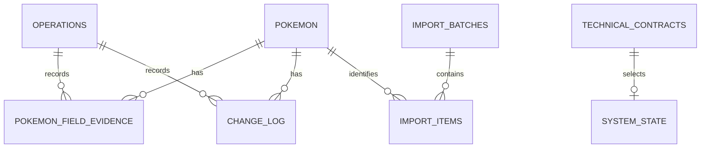

# Data model — schema 0.3.0

The migration files define exact types, constraints and privileges.

## Application tables

| Table | Purpose |
|---|---|
| pogo.pokemon | Current individual inventory |
| pogo.pokemon_field_evidence | Selected and alternative field observations |
| pogo.operations | Unique idempotency keys, payloads and completed results |
| pogo.change_log | Insert/update snapshots and evidence events |
| pogo.import_batches | Stable source batch identifiers |
| pogo.import_items | Unique source item within a batch mapped to a Pokémon |
| pogo_meta.ideas | Extension backlog |
| pogo_meta.technical_contracts | Versioned runtime instructions |
| pogo_meta.system_state | Singleton project binding, schema/contract versions and readiness |

The two PoC schemas are historical test environments, never inventory sources.

## Pokémon fields

| Category | Fields |
|---|---|
| Identity | id, pokedex_number, species_name, form, nickname |
| Combat | cp, max_hp, iv_attack, iv_defense, iv_stamina, level |
| Flags | is_shiny, is_shadow, is_purified, is_lucky, is_favorite |
| Max | max_type, max_attack_level, max_guard_level, max_spirit_level |
| Moves | fast_move, charged_move_1, charged_move_2 |
| Appearance | size_class, gender, costume_code, background_code |
| Origin | acquisition_method, catch_location, ball_type |
| Dates | caught_on, acquired_on, egg_received_on, hatched_on, traded_on |
| Measurements | height_m, weight_kg |
| Lifecycle | status, version, created_at, updated_at |

IVs range from 0 to 15. CP and HP are positive. Level accepts half steps from 1 to 55 as a structural bound, not a claim about current game mechanics. Max levels range from 0 to 3. Status is owned, transferred, traded or unknown; NULL means unspecified. The schema requires a Pokédex number or a nonblank species name. Permanent evolution retains the UUID and updates or clears affected fields. Temporary Mega/Primal forms must not overwrite permanent combat values; separate modeling is planned.

## Evidence

Each observation stores the field name, JSONB observed value, source type/reference, verification status, observed/verified/recorded timestamps, current flag and operation reference. A partial unique index allows at most one current observation per Pokémon and field. Verified observations require a verification timestamp. Alternative raw observations do not update the current record or its version.

## Planned extensions

Resources and movements, strategic goals, planned actions, decisions, assessments, research, events, teams, preferences, Pokédex progress, Max move name/type and temporary Mega/Primal transformations. No tables for these are implied by this roadmap.

## Project organization

`pogo_meta.project_chats` and `pogo_meta.project_config` store current and historical revisions. See [Project context](project-context.md).
